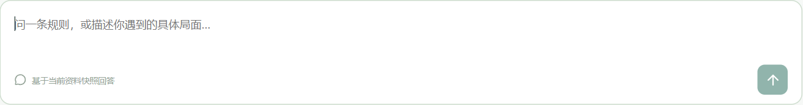

# 1.7：I01追问补全、输入焦点修复与GitHub交付

日期：2026-11-12。基线为1.6，沿用Docker主库、deepseek-flash、资料快照和原费用账本。QQ、真人试用仍按既定决定移出。本轮按用户追加要求准备上传至[私有GitHub仓库](https://github.com/gujianyi0/qinggui-xinyuesha-assessment)，不添加其他协作者。

## 结果与覆盖范围

- **I01已关闭**：明确追问武将、具体技能或卡牌名称、触发阶段/时机、目标与关键局面，保留尚未保存和网页明确确认边界。
- **输入框长竖线已修复**：回答正文后点击输入区域空白，会聚焦实际文本框；同类保护应用于搜索、登录和反馈字段。用户原Edge页面按原步骤复核通过。
- **162项后端、7项前端测试及生产构建通过**；焦点浏览器7项检查通过、页面错误0。浏览器检查使用接口替身，不调用模型、不写业务库，与实模记录分开。
- 固定集复测 **I01/I02/M01/M02/M03共5条8回合**，另加一个补充武将/技能的合成多轮场景FI01 **2回合**；10回合均完成，33处引用完整性问题0，逐条语义核对通过。
- 本轮未重跑全部32条，也未重复一小时稳定性和17组基础设施故障矩阵；1.6历史结果保持原样。

## FIX31：反馈追问不能只依赖模型自行补全

**原始输入**：“技能没生效，帮我反馈。”

1. **错误与定位**：1.6最终I01有通用草稿、预期、步骤、版本和确认提示，但没有明确索要武将/技能名。已有指令不足以保证每次包含必要字段。以真实Agno SDK配合可控HTTP响应，故意返回同样缺项的正文，新防回归在修复前实际失败：[失败XML](evidence/v17-i01-protocol-before.xml)。
2. **修改**：在当前反馈主题涉及技能、武将、卡牌、结算或伤害时，生成程序控制的结算核对清单。它包含具体实体、时机、目标、关键局面及其余缺项，并明确“已说明的信息无需重复提供”。只作为待核对项，不冒充玩家陈述或引擎事实。
3. **保存与流式一致**：清单写进prepare_feedback_context回执；模型正文非空后才附加到流式增量和最终保存文本。模型空正文仍失败，不能靠清单变成成功。没有正式保存权限，仍须到网页核对草稿修订并确认。
4. **多轮边界**：识别“武将是…／技能是…／我是曹操…”这类事实补充，继续整理同一反馈；普通新问题和“我是谁？”不因新规则被当作补充。新的明确反馈主题会重新判断清单范围，纯客户端问题不附武将清单。
5. **防回归**：检查故意漏问的模型正文仍得到具体清单；SSE拼接=运行正文=历史消息；审计可查且正式反馈不增加；另测空正文、客户端不附清单、技能名“反馈”、话题切换和组合字段补充。早期34项针对性通过，最终完整162项通过。

影响位置：[feedback_context.py](../backend/app/feedback_context.py)、[runtime.py](../backend/app/runtime.py)、[协议测试](../tests/test_agno_protocol.py)、[反馈边界测试](../tests/test_full_regression_fixes.py)。普通规则/数据/裁定指令未修改；本轮M01/M02的提示词标识与1.6相同。

## FIX32：点击空白留下整块高度的页面选择光标

**用户步骤**：先点回答正文，再点输入框旁边或其他输入区域的空白；出现贯穿整个空输入区域的黑竖线。

1. **现场复现**：用户已登录Edge中，回答正文后点击composer左内边距，activeElement为BODY，文档选择落在FORM位置；黑线按空的内联textarea高度绘制，而不是正常输入行。输入框实际高60px、行高21.6px，Windows页面DPR为1.5。没有把浏览器设置的猜测当成已证明的根因。
2. **修改**：输入表面的左键空白点击转交给对应真实输入控件，阻止落在容器上的默认选择；textarea使用block布局，避免内联替换控件的整行光标。登录跳过隐藏身份字段；反馈字段各自定位自己的控件，搜索图标/空白聚焦搜索输入。
3. **保留原生交互**：不拦截输入控件、按钮、链接、标签、可编辑元素，不处理右键，不用全局user-select:none隐藏问题。回答仍可选择，文本框原生选区和按钮事件保留；组合输入事件及Shift+Enter不发送，普通Enter仍发送。
4. **修复前后**：[组件修复前失败](evidence/v17-input-focus-before.json)；[7项前端最终测试](evidence/v17-frontend-final.json)；[浏览器最终检查](evidence/v17-input-focus/browser-final/summary.json)。另在用户原Edge重新加载部署，按相同步骤确认activeElement为chat-message、textarea为block，未出现整块长竖线。

影响位置：[共用焦点处理](../frontend/src/components/inputSurface.ts)、Chat、Feedback、Library、Login及styles.css。前端测试覆盖空白聚焦、原生选区、右键、按钮、组合输入/换行/发送和反馈字段。没有更改浏览器全局设置。



## 相关真实样例逐条复测

| 样例 | 回合数 | 重点核对及实际结果 |
| --- | ---: | --- |
| I01 | 1 | 具体武将、技能/卡牌、阶段、目标、局面明确列待补；没有把“没生效”变成“已发动”；文字草稿不自动保存 |
| I02 | 1 | iOS/0.5.25卡住事实保留，追问客户端操作与恢复；没有结算核对清单或无关武将必填 |
| M01 | 2 | 承接诸葛亮与空城，无手牌前提及杀/决斗范围正确；没有缩成“普通杀” |
| M02 | 2 | 承接酒与濒死，自救回复1点且不能给其他濒死角色使用；引用对应牌面 |
| M03 | 2 | 合并iOS相册、0.5.25本地修改版与退出重开恢复；不重复询问已给版本，不加结算清单，不猜原因 |
| FI01（新增合成） | 2 | 第二轮补“武将是曹操，技能是奸雄…身份模式…Windows…0.5.25本地修改版”仍保持反馈整理，只用本会话事实；实体/版本保留，继续问预期、具体局面和步骤，不自动保存 |

原固定文件SHA256仍为`63d7c970e34124273725c2099e538d012cc715d20050d683ec8f13282a114cb3`，未重写固定预期或1.6失败记录。FI01使用[独立合成样例文件](../evaluations/feedback-followup-v17.json)。

| 运行 | 引用/问题数 | 输入/输出tokens | 费用估算 |
| --- | --- | --- | --- |
| 固定5条8回合 | 30 / 0 | 23533 / 2593 | 0.067810元 |
| 新增FI01两回合 | 3 / 0 | 2080 / 780 | 0.010400元 |

固定集：[原始记录](../evaluations/results/live-feedback-v17-20261112-01/results.jsonl)、[引用审计](../evaluations/results/live-feedback-v17-20261112-01/citation-audit.json)、[Codex核对](../evaluations/results/live-feedback-v17-20261112-01/codex-review.json)。新增多轮：[原始记录](../evaluations/results/live-feedback-followup-v17-20261112-01/results.jsonl)、[审计](../evaluations/results/live-feedback-followup-v17-20261112-01/citation-audit.json)、[核对](../evaluations/results/live-feedback-followup-v17-20261112-01/codex-review.json)。这是Codex核对，不是独立真人试用或公司验收。

## 程序、部署与数据核对

| 检查 | 实际结果及证据 |
| --- | --- |
| 后端全套 | [162项通过](evidence/v17-pytest-final.xml)，含18项Agno协议；QQ历史协议保留但不启用真实QQ |
| 前端 | [7项通过](evidence/v17-frontend-final.json)，[TypeScript与生产构建](evidence/v17-frontend-build-final.log)通过 |
| 焦点浏览器 | [7组](evidence/v17-input-focus/browser-final/summary.json)：6次正文→空白点击、文本选择、换行/发送、6个反馈控件、搜索、登录、移动端；接口全替身，不写数据库或计费 |
| 源码与镜像 | [1.7.0及26个后端文件一致](evidence/v17-feedback/runtime-final.json)；追加界面修复部署使用当前BRXwD8U0.js/Cml1dYb1.css资产 |
| 主库/预算 | [最终状态](evidence/v17-feedback/final-state.json)：正式反馈5条、草稿5条均未增加，运行/任务/未结算0；累计约9.800032元、本轮增加约0.078210元、预留0 |

费用均按项目单价估算，不是供应商账单；总额200元不重置。模型回复和程序核对清单属于两类内容，引用仅绑定实际用户陈述或工具回执，不把清单变成玩家事实。

构建经过：标准1.7构建成功。交付哈希检查发现一个晚加的话题边界没有进入首份镜像，保留[首次检查](evidence/v17-feedback/runtime-check.json)，随后在同一成功构建的1.7基础镜像重建应用层并确认26文件一致，才开始付费评测。界面修复另行标准web构建。新增焦点浏览器脚本首次使用错误按钮名“新建草稿”而超时，实际为“新建反馈”；[失败说明](evidence/v17-input-focus/browser/attempt-error.json)保留，修正脚本后全7组通过，未放宽产品断言。

复测命令在项目根目录执行：

```powershell
.\.venv\Scripts\python.exe -m pytest -q
Set-Location frontend
npm test
npm run build
Set-Location ..
.\.venv\Scripts\python.exe -X utf8 scripts/verify_input_focus.py --output-dir docs/evidence/focus-review-unique
.\.venv\Scripts\python.exe -X utf8 -m evaluations.run --api-url http://127.0.0.1:15174/api --mode live --only I01,I02,M01,M02,M03 --label live-feedback-review-unique --concurrency 1
```

## 当前边界与交付

I01缺项与长竖线均已关闭；Markdown以纯文本显示的阅读体验建议仍保留。F01的真实主库故障保护、1.6未执行的其他验证及正式Leader验收，不因本轮定向复测自动改成通过。QQ和真人试用不重新加入范围。

本轮保存为指定本地git **1.7**，保留旧标签。用户明确授权上传项目，目标为本人账号下的私有仓库；排除凭据、数据库备份、运行卷、私人配置及下载缓存，并在首次上传前检查Git历史。GitHub工作流结果可在[Actions](https://github.com/gujianyi0/qinggui-xinyuesha-assessment/actions)查看，不把本机测试冒充托管运行结果。
