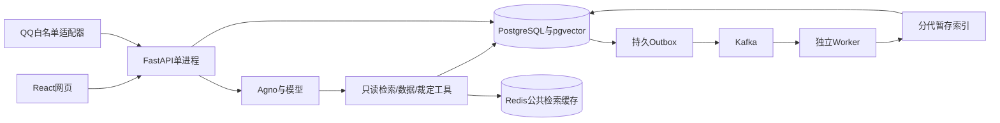

# 轻归新月杀助手执行计划书

日期：2026-11-10。对象：故剑遗，已入职后的完整个人学习目标。正文记录实施方案，访谈原话和决策见[问答附录](问答与决策记录.md)。本次不继承以往用户偏好；以本次访谈、个人任务和实际运行证据为准。

> 2026-11-11范围调整：按用户要求，移除招募2～3位玩家、真人试用及据此改进的执行环节。固定样例、自动化、真实依赖和QQ功能联调继续；原公司材料及历史记录保留，不把移除项记为已完成。

## 1. 目标和完成定义

普通玩家能从一个问答入口查清新月杀资料、补充具体局面、核对已验证交互，并把结算或客户端异常整理成本人明确确认的反馈。产品入口为React网页及独立轻归QQ适配器，两者使用同一后端。通过完整主功能P01–P10、后台B01–B07和提交材料准备验收，最终结论由Leader评估。

“代码已实现”“本机验证通过”“真实依赖验证通过”“公司验收通过”分别报告；不能由前一项推导后一项。正式截止日、验收人和演示时间未确认，以下排期是工程建议。

## 2. 已确认范围

| 项目 | 决定 | 验收方式 |
| --- | --- | --- |
| 使用者 | 普通游戏玩家 | 固定任务场景、演示与功能验证；不再安排真人试用 |
| 游戏 | 新月杀 | 固定本地修改版快照，注明版本与来源 |
| 资料 | 外层standard、standard_cards、maneuvering | 清单、哈希和引用核对，不混入其他镜像包 |
| 核心链路 | Python/FastAPI/PostgreSQL/Agno | 一次真实模型请求经过工具并可重启查询 |
| 检索 | 本机CPU BGE-small-zh-v1.5，锁定revision | 512维向量、pgvector索引、Top-K结果与引用 |
| 裁定 | 首版SC01–SC08 | 离线实际执行，保留前提、断言、事件轨迹 |
| 反馈 | 结算异常和客户端体验 | 草稿、缺失信息、修订号、确认、重复保护 |
| 后台 | 批量解析并索引指定快照 | Kafka、独立Worker、HTTP状态及取消 |
| Redis | 仅公共检索缓存 | TTL300秒，缓存停机或过期可回源 |
| QQ | 独立考核入口，专用白名单 | 默认dry-run；复用账号前暂停原回复进程 |
| 预算 | 全考核模型API≤200元 | 160元提示，预留费用，耗尽停止新调用 |
| 部署 | 本机Compose | 数据卷、迁移、健康检查、重启与故障矩阵 |

不修改原轻归私人记忆或运行库，不连接真实外部工单，不自动上传仓库、联系同事或发布公司资料。

## 3. 玩家流程

1. 登录alice或bob测试身份，新建会话，选择固定资料快照。
2. 查询武将、卡牌、技能属性时调用结构化工具；解释规则时检索资料，回答展示来源、片段和快照。
3. 继续追问时只带当前身份和会话的有限历史。资料不足、版本不明或冲突时明确说明并追问。
4. SC01–SC08先核对必要条件，再读取已验证裁定；条件不同或证据失效时不能沿用确定结论。
5. 问题反馈先整理实际现象、预期、步骤、局面，客户端问题额外记录平台和版本；缺少内容明确标注。
6. 用户查看当前修订并明确确认后写入正式记录。重复确认返回同一条，旧修订被拒绝；模型不能授予确认权限。
7. 后台导入返回任务号，玩家可离开页面、查询、取消；失败说明原因、尝试次数与能否重试。

## 4. 架构与调用边界

会话、消息、运行、工具调用、草稿、反馈、任务、尝试、Outbox、发布指针及费用账本持久化到PostgreSQL。私人接口从后端token推导user_id；用户输入、模型输出、QQ昵称及群管理员身份均不能指定他人数据范围。公共游戏资料独立标明。

API部署限定一个进程，启动将上次中断的running运行标记为可重试失败，并保守结算未决费用。若未来扩为多个API进程，须先为对话运行实现租约，不能直接加workers。

## 5. 资料和裁定

原始材料冻结时生成文件清单及SHA256；每条说明保留标题、路径、行号、类型、版本和摘录。现有198条正文按资料语义单元提取；索引时按320字符、64重叠切成659块，保留原来源与字符偏移，并检查token上限，禁止静默截断。真实BGE和pgvector索引已实际运行，见[依赖验证](真实依赖验证记录.md)。

导入先验证快照白名单，按16条批次生成向量并写暂存区；全部成功后切换发布指针。检索融合词法和向量，Top-K默认5、上限8。未索引时只提供词法降级并标明模式，不能作为语义检索验收。

SC01青龙/空城、SC02无双/八卦/鬼才、SC03酒火杀/连环/藤甲/白银狮子、SC04青釭剑传导范围、SC05流离转移、SC06贯石斧/连营、SC07奸雄/连环、SC08武圣转化诸葛连弩。证据须有非零执行数、至少3个断言、脚本和引擎哈希、对应资料快照。fake_backend的边界必须在演示中说明。

## 6. 模型、输出与故障

真实模式配置独立的URL、精确模型ID、密钥、单价；不从旧项目隐式加载。Agno异步流式运行，工具最多6次；默认并发2，超时60秒，输出2048 tokens。Pydantic验证最终正文非空及长度；工具返回和引用另按实际快照核对。流中断、取消、格式失败和超时均持久化，失败不会写成成功消息。

费用调用前原子预留，返回用量时结算；用量缺失或进程中断按预留保守记账。记录模型ID、提示词版本、耗时、工具和用量。该账本只覆盖本项目调用，最终按服务商账单核对费用。

## 7. 后台可靠性

任务＋Outbox同事务；Outbox发送成功才标投递。Kafka关闭自动位点提交和自动存储。业务提交或持久安排重试后才提交位点；异常时回退本地消费位置，防止后续消息提交越过失败消息。单条坏信封记topic/partition/offset后结束，业务坏输入留存任务失败原因。

幂等以(user_id,idempotency_key)和业务唯一约束保证。领取任务执行原子状态和代次检查，租约默认60秒、心跳10秒；过期恢复推进代次，旧实例不能继续发布。临时失败最多3次、延迟10/30秒，安排持久化后释放当前消息，让其他任务推进。

queued/retry_wait可直接取消，running标cancel_requested，在分块边界和最终发布前检查；终态succeeded/failed/cancelled不回退。取消不撤销已有费用、已写暂存区等副作用，未发布暂存不参与检索。后续可增加暂存清理，不作为当前正确性前提。

## 8. 排期与工作包

约260小时，以每周35～40小时估算7～8周；含28小时缓冲。此为总项目建议，实际已完成部分见进度记录，不把本轮时长当作全部开发工时。

| 阶段 | 小时 | 主要产物 | 退出条件 |
| --- | ---: | --- | --- |
| W1范围/环境/链路 | 24 | 计划、依赖、迁移、最小API | 两身份可登录，一次请求可保存 |
| W2资料与工具 | 40 | 快照、结构数据、BGE/pgvector | 两类工具可追踪，来源与版本可核对 |
| W3问答和输出 | 32 | Agno、多轮、SSE、失败/预算 | 真实模式成功、失败均留记录 |
| W4反馈和网页 | 32 | 草稿确认、React核心流程 | 修订冲突、重复确认、隔离通过 |
| W5后台可靠性 | 40 | Kafka、Worker、Outbox、Redis | 重复、重试、租约、取消及故障恢复通过 |
| W6裁定场景 | 24 | SC01–08脚本及轨迹 | 8场景在冻结逻辑上执行并标清范围 |
| W7评测与验收准备 | 24 | 32固定样例前后、故障证据和演示核对 | 同组模型记录、至少3修复、证据与演示可复查 |
| W8交付与演示 | 16 | Compose复现、README、材料核对 | 同一仓库可复现，成功/失败可演示 |
| 缓冲 | 28 | 模型、环境、依赖故障修正 | 不用于免除验收要求 |
| 合计 | **260** | | |

仅在业务边界和已授权范围内自主推进；正式截止日、验收口径、资料对外共享、真实账号重新授权等由用户/负责人决定。

## 9. 测试和证据方案

| 层级 | 内容 | 证据 |
| --- | --- | --- |
| 程序契约 | 校验、两身份隔离、重复确认、格式错误、超时、并发、预算 | pytest及前端回归测试 |
| 任务状态机 | 重复领取、取消竞争、旧代次、坏输入、三次耗尽、缓存不可用 | 持久状态断言 |
| 真实基础设施 | PostgreSQL锁和向量、Kafka重投递、写库后崩溃、Redis过期/停机 | Compose日志、任务/分区/位点和恢复报告 |
| 规则执行 | 8个固定场景与源码哈希 | rulings/evidence |
| 模型替身 | 32固定样例HTTP/SSE链路 | evaluations/results中mode=mock |
| 真实模型 | 同一用例集前后运行，审查工具、引用、答案及用量 | mode=live，人工逐条审核 |
| 浏览器 | 登录、问答、资料、草稿编辑确认、任务取消、移动布局 | 截图、错误列表、运行摘要 |

32条覆盖8规则、6结构化、8裁定、3多轮、2版本冲突、2无答案、1工具失败、2反馈不足。机械检查不等于语义通过；语义与来源核对单独记录。真人试用按本次决定不执行，也不以自动化冒充。

## 10. 依赖和风险处理

| 依赖/风险 | 当前处置 | 何时需要外部输入 |
| --- | --- | --- |
| 本机无Docker | 提供SQLite替身运行和完整部署配置，容器结果保留待验证 | 可用Docker环境 |
| 真实模型缺配置 | live模式明确失败，不猜ID和价格 | 精确配置和价格在本项目本地填写 |
| 本地向量模型 | 提供revision解析/下载脚本，不伪造锁定值 | 下载完成并配置revision |
| QQ共用账号 | 默认dry-run、启动互斥检查、白名单 | 明确连接及白名单后安排试用 |
| 引擎测试替身边界 | 记录实际Lua执行和fake_backend范围 | 若要求线上验证需另约范围 |
| 公司材料与源码许可 | 本地保存来源，不上传 | 仓库共享对象和许可核对 |
| 正式时间未定 | 按建议工作包推进，保留缓冲 | Leader确认期限与验收安排 |

## 11. 交付步骤

1. 按[验证与差距](验证与差距.md)完成真实依赖及模型剩余验证。
2. 使用固定32条样例完成真实模型前后运行和逐条审查，补足输入、工具、引用、Token、费用和版本。
3. 汇总已发生的真实问题修正、固定样例与故障恢复证据，完成成功/失败演示核对。
4. 在干净环境复现迁移、启动、资料导入、成功与失败请求、重启查询及Worker恢复。
5. 核对源码、依赖锁、示例配置、来源许可、三次修复和AI代码修复说明，确认共享对象后放同一GitHub仓库。
6. 提交主功能、后台能力的真实状态及仓库链接供Leader验收，不自行宣称公司考核通过。

依据：[本地个人学习目标](../../Skill/biteagle-onboarding-assessment/references/personal-learning-goals.md)、[通用考核制度](../../Skill/biteagle-onboarding-assessment/references/assessment-policy.md)、[已确认问答](问答与决策记录.md)。
