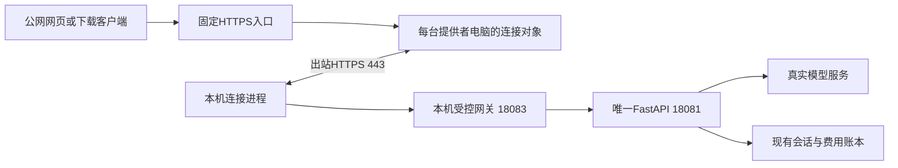

# 本机对外服务与下载版客户端

公网网页：<https://qinggui-assessment.c2115259095.workers.dev/>。GitHub：<https://github.com/gujianyi0/qinggui-xinyuesha-assessment>。

访客直接点击“进入工作区”，无需模型账号、API密钥或演示密码。网页与下载版客户端使用同一个本机后端，由提供者承担模型费用。浏览器保存随机访客标识，会话与反馈保存在提供者电脑；清除浏览器存储或更换浏览器会形成另一个身份。本服务用于内部考核测试，按用户要求不设置按人、按天或按频率的问答配额。原先约定的200元模型总预算仍生效，未知用量按已预留额度保守结算。

## 别人如何使用

可以直接打开公网网页。希望把界面运行在自己电脑上的人，安装Docker后执行：

```powershell
git clone https://github.com/gujianyi0/qinggui-xinyuesha-assessment.git
cd qinggui-xinyuesha-assessment
docker compose -f compose.client.yaml up -d --build
```

然后打开 <http://127.0.0.1:15176/>。此模式只启动网页客户端，不需要复制`.env`、填写密钥、下载BGE或启动数据库/Kafka。客户端连接上述公网服务，不向访客提供模型供应商凭据。停止客户端：

```powershell
docker compose -f compose.client.yaml down
```

项目原有`docker compose up`仍是完整自托管模式，默认模型替身，见README；本文件的`compose.client.yaml`是使用提供者真实模型的入口。

## 这台提供者电脑如何运行

当前唯一权威部署为`qinggui-assessment-live`，网页15174、API18081，会话、索引和费用账本使用原迁移后的PostgreSQL卷。不得另开旧原生副本或新空账本承担相同付费服务。

启动现有主部署及对外连接：

```powershell
pwsh -File scripts/start_public_service.ps1
```

停止对外入口，不停止本机Docker、不删除会话或账本：

```powershell
pwsh -File scripts/stop_public_service.ps1
```

查看`.local/public-entry/status.json`，`state=online`表示已完成远端拉取响应；实际健康另由公网登录和问答验证。`.local/public-entry/relay-events.jsonl`记录请求路径、状态、耗时及脱敏的断线原因，不记录问答正文或鉴权头。当前没有设置Windows登录自启动；重启电脑后执行启动命令。提供者电脑须保持开机、联网且Docker和连接进程运行，离线时网页会提示服务不可用。

## 首次配置或恢复部署

本机模型密钥只在忽略提交的`.env.docker-live`中。新增私有连接配置位于`.local/public-entry/config.json`；`service_token`保护本机内部访客接口，`signing_key`签发访客令牌，`edge_token`仅用于本机连接进程到本机网关。Cloudflare仅保存独立的`CONTROL_TOKEN`，用于认证提供者HTTPS拉取和回复，不是模型密钥。

先完成README中的真实主库迁移和模型配置，再执行：

```powershell
.\.venv\Scripts\python.exe -m scripts.prepare_public_service
cd public-entry
npm ci
npx wrangler whoami
cd ..
.\.venv\Scripts\python.exe -m scripts.deploy_public_entry
pwsh -File scripts/start_public_service.ps1
```

配置脚本不打印密钥，不修改现有模型、数据库或预算配置。首次加入`PUBLIC_SERVICE_TOKEN`后须按现有Compose流程重建/更新API环境；当前电脑已经完成。部署脚本只上传静态网页和连接控制令牌，完全不读取`MODEL_API_KEY`。`public-entry/wrangler.jsonc`使用本次账号的独立Worker及一个SQLite Durable Object类型；换账号部署需修改Worker名、客户端API地址并重新配置本机连接地址。原知识浏览网页的Worker未修改。

## 请求路径与边界



本机网关仅转发访客会话、问答、资料、反馈及本人运行查询/取消。网页alice/bob登录、资料导入任务、内部QQ接口、API文档和管理操作不向公网转发。访客令牌带签名和有效期；持有原本机账号令牌也不能直接通过公共网关。数据库继续检查每条记录归属。

公网问答通过提交运行后轮询持久结果实现，本机15174保留SSE流式。重复提交相同访客、同一请求编号返回同一运行，不重复产生付费调用；进度查询的临时故障重查同一运行，不重新提交问题。点击停止会显式取消；网络查询失败本身不会取消模型任务。模型沿用历史静态资料而未再查工具时，可按同会话/同快照/文件哈希复核续用来源并保存回执；不会自动继承旧局面的引擎裁定。取消可能已有费用，已发生的费用不会回退。

当前网络无法连通Cloudflare Tunnel所需端口，临时隧道方案未作为可用结果交付。长期WebSocket连接又在严格观察中出现停顿，最终采用443端口短时HTTPS拉取和回复；每次拉取最长等待8秒，含失败退避、重新拉取和单实例保护。连接层最多同时等待32个HTTP请求，这是并发资源保护，不是问答次数配额；模型原有并发设置保持1。连接断开时在途HTTP请求可失败；业务运行、消息和账本仍以本机PostgreSQL为准。

验证脚本：`python -m scripts.verify_public_service`会产生两轮真实模型费用；`--resume`仅重试先前浏览器身份的失败追问。`python -m scripts.verify_public_recovery`不产生模型请求，会断开一次反向连接并检查自动恢复及两分钟观察。证据及失败记录见[1.8报告](1.8-本机共享真实问答与验证-20261112.md)。
