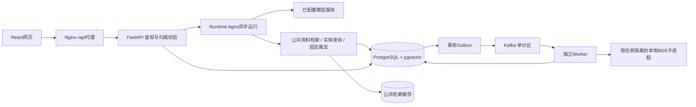

# 架构、接口与数据访问边界

1.10展示层补充（2026-11-14）：API和数据库仍保留原始正文与结构化引用，网页仅转换助手可读正文；详细来源由回答末尾按钮按需展开。模型提示词改为简洁中文，不抄写工程位置。数据库迁移仍为0002；回归范围见[1.10报告](1.10-回答展示与浏览器排查-20261114.md)。以下架构内容保持1.9基线。

更新：2026-11-13，1.9。当前验证以[1.9报告](1.9-裁定约束断线恢复与完整回归-20261113.md)为准，历史故障证据继续保留。当前主库备份见[备份与恢复](Docker主库备份与恢复.md)。

## 请求与后台调用链

API在事务中建立用户输入和Run，再由Runtime执行模型与工具、保存工具回执、正文、引用和用量。模型只决定受控工具调用；权限、反馈确认、任务终态和费用结算由业务代码决定。使用单个API进程和单个Worker；不是多API高可用实现。

1.9中，网页先存请求编号再提交受理，断线按同编号查原运行，不换编号重复调用。裁定检测使用选定场景、有限历史及玩家显式条件；模型不得自填确认，未验证内容不流出。普通模型上下文仍为有限近期消息，裁定场景回溯最多32条用户输入，非无限记忆。版本一致性和普通弃牌计算在生成前预查来源；维护说明与上游规则来源分开标。

## 平台和会话数据边界

当前没有QQ战绩、其他群聊、玩家账号数据库或互联网实时检索工具。模型不能通过用户文字获得这些权限，也不能把搜索无结果说成已查询过私人资料。

网页登录返回有时效的Bearer token，数据库只存token摘要。会话、Run、草稿、反馈和任务按后端user_id限定，其他用户的资源返回404；列表也过滤归属。密码按scrypt加盐存储。前端隐藏按钮不能代替后端校验。

模型上下文为本会话有限的近期消息，用户陈述引用绑定会话、消息及原文SHA256；不是独立事实核验。公共游戏资料检索缓存不保存私人对话。当前QQ运行配置已清理，旧`integrations/onebot`、`/internal/qq/*`和空的历史表保留；无桥接凭据时接口拒绝调用，不运行真实QQ连接。

## 当前主要HTTP接口

网页经`http://127.0.0.1:15174/api`访问；API直接端口18081，OpenAPI在API的`/openapi.json`和`/docs`。以下路径按API内部路径列出。

| 方法和路径 | 行为及主要输入 |
| --- | --- |
| GET /health | 数据库、缓存、模型模式、资料快照、索引和预算；不是所有后台任务推进的充分证明 |
| POST /auth/token | username/password；两个本机演示身份，不把token写进报告 |
| POST /sessions；GET /sessions | 创建/列出本人的会话；title限制160字符 |
| GET /sessions/{id}/messages | 本会话消息及引用 |
| POST /sessions/{id}/submissions | 必须提供 request_id UUID；先受理并后台运行，重复相同载荷返回原 run_id，改动载荷409 |
| GET /sessions/{id}/requests/{request_id} | 按本人原请求编号找回运行，断线不需要生成新编号 |
| POST /sessions/{id}/requests/{request_id}/cancel | 原始载荷与编号匹配；未受理时建立取消标记，迟到提交不能再启动模型 |
| GET /runs/{id}/events | 本机网页读取可重连 SSE，断开只分离观察；已保存终态可回放，公网仍轮询 |
| POST /sessions/{id}/runs | message 1–8000字符、可选snapshot_id；返回POST SSE，同会话已有运行时409 |
| GET /runs/{id}；POST /runs/{id}/cancel | 已存正文、引用、工具、用量；取消运行 |
| GET /catalog/entities；/catalog/snapshots；/catalog/rulings | 实体有限查询、快照及已记录裁定；实体kind仅general/card/skill |
| POST /feedback-drafts | category rules/client；实际、预期、步骤、条件、平台和版本；可选本人的session_id |
| PATCH /feedback-drafts/{id} | 当前revision和可编辑字段；不能改变session_id，未知字段或null拒绝 |
| POST /feedback-drafts/{id}/confirm | 必须含revision；正式反馈draft_id唯一，重复确认返回原记录 |
| GET /feedback | 仅本人已经确认的反馈 |
| POST /jobs | snapshot_id和idempotency_key；同身份同幂等键返回同任务；202 |
| GET /jobs；GET /jobs/{id}；POST /jobs/{id}/cancel | 本人任务、尝试、原因、进度及取消 |

SSE事件为started/progress/delta/citations/completed/failed/cancelled；正文增量不等于业务已成功，以终态和可查询Run为准。输入错误一般422，未登录401，资源不属于本人404，修订/状态冲突409，数据库连接故障503且retryable。模型错误通过SSE和持久Run说明。

## 工具、状态和持久化

- `search_knowledge`：当前固定快照规则/技能检索；BGE/pgvector召回结合直接规则段落，返回来源。Redis键包含快照、发布代次、模型revision、问题等，TTL300秒，坏结构或停机回源PG。
- `query_game_data`：结构化武将、卡牌、技能及有限筛选，属性、说明、牌堆分别关联来源；不执行模型给的SQL。
- `get_verified_ruling`：只接受单个SC01–SC08；默认匹配明确条件，reference只查看固定已执行记录。缺条件继续追问，不能把记录前提当玩家事实。无任意代码或文件路径执行。
- 反馈：文字整理→网页草稿→修订核对→明确确认→正式记录。聊天“好的”不会自动确认，确认前不生成正式反馈。
- 任务：queued/running/retry_wait进入succeeded/failed/cancelled终态；租约60秒、心跳10秒、最多3次尝试、退避10/30秒。暂存完毕再原子发布，旧代次不能覆盖新结果。
- Kafka手动提交位点：业务结果或持久重试安排先落库。消费异常seek回原位置；Outbox发送与标记之间可能重投，业务唯一性吸收重复。
- PostgreSQL保存用户/token摘要、会话/消息/Run/工具/用量、反馈、任务/尝试/Outbox及索引发布数据。Redis无权替代这些业务记录。
- 费用在统一账本预留和核销，200元预算不随迁移重置；用量缺失按预留保守记账并标估算。单价估算不是供应商账单。

当前主库为Docker；旧原生库由启动标记阻止写入。取消不能退回已发生的供应商费用，运行和发布的竞争结果须按持久终态核对。来源授权、冻结快照及第三方组件见[来源与复用说明](来源与复用说明.md)。

## 1.8：共享真实问答入口

另增`public-entry`固定HTTPS网页及每台提供者电脑的Durable Object连接，`scripts/public_service.py`主动进行出站HTTPS443短时拉取和回复；本机`backend/public_gateway.py`仅绑定18083，复用原API18081及PostgreSQL费用总账。公共客户端不直接连接供应商，也不接触alice/bob登录、资料导入、QQ或管理接口。

`POST /api/auth/guest`由网关签发带签名的访客令牌；主API的`/internal/public/identity`和`/internal/public/sessions/{id}/runs`受独立服务身份保护。公共run请求包含UUID请求编号，数据库事务与确定性run_id保证重复编号不重复计费。客户端GET已保存运行结果，公网不依赖SSE；本机原流式接口保持。`/__poll`、`/__reply`、`/__status`、`/__disconnect`均须独立连接控制凭据。

按用户最新要求无问答配额；保留预算、归属校验和并发/输入保护。来源和费用与原主流程一致。使用和私有配置见[本机对外服务](本机对外服务.md)。
